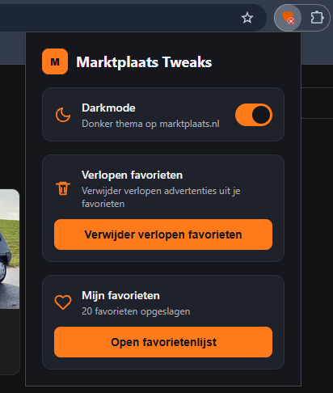
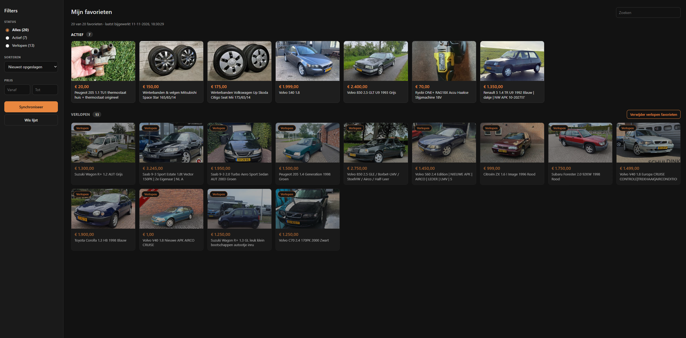

# Marktplaats Tweaks

Chrome-extensie met handige extra's voor Marktplaats:

- **Darkmode** voor heel marktplaats.nl, met een schakelaar in de popup.
- **Verlopen favorieten verwijderen** met één klik.
- **Favorietenlijst** met zoeken, filteren en sorteren, ook als je de Marktplaats-pagina niet open hebt.

## Installeren

1. Open `chrome://extensions` in Chrome.
2. Zet rechtsboven "Ontwikkelaarsmodus" (Developer mode) aan.
3. Klik op "Uitgepakte extensie laden" (Load unpacked).
4. Selecteer deze map (`chrome plugin`).

## Gebruik

### Darkmode

Zet in de popup de schakelaar "Darkmode" aan. De keuze wordt onthouden en werkt direct in alle open Marktplaats-tabs.

### Verlopen favorieten verwijderen

1. Ga naar je favorietenpagina: https://www.marktplaats.nl/my-account/favorites/index.html
2. Klik op het extensie-icoon en druk op "Verwijder verlopen favorieten".
3. Wacht tot de status "Klaar" toont, met een overzicht van de verwijderde items.

Verwijderen op Marktplaats is definitief.

### Favorietenlijst

1. Open je favorietenpagina op Marktplaats. De extensie bewaart de advertenties die je daar ziet.
2. Klik in de popup op "Open favorietenlijst".
3. Klik op "Synchroniseer" om de volledige lijst binnen te halen. Dit scrolt de favorietenpagina helemaal door.
4. Zoek, filter op status of prijs, en sorteer. Verlopen advertenties staan apart onder de actieve.

## Werking (kort)

- `darkmode.js` en `darkmode.css` zetten een klasse op de pagina en passen een kleurfilter toe. Foto's en video's worden teruggedraaid, zodat ze er normaal uitzien.
- `content.js` scrollt de favorietenpagina volledig door (infinite scroll) om alle items te laden.
- Items worden herkend als verlopen via het label `Verlopen` (badge) dat Marktplaats zelf toont.
- Per verlopen item wordt op de knop "Verwijderen uit favorieten" geklikt, en gewacht tot het item uit de lijst verdwijnt.
- Actieve favorieten worden niet aangeraakt.
- `content.js` bewaart titel, prijs, foto, link en status van elke favoriet in `chrome.storage.local`. `favorites.html` en `favorites.js` tonen die lijst.

Als Marktplaats de paginastructuur wijzigt en de detectie niet meer werkt, pas de tekst-matching in `EXPIRED_TERMS` of de `aria-label`-checks in `content.js` aan.
